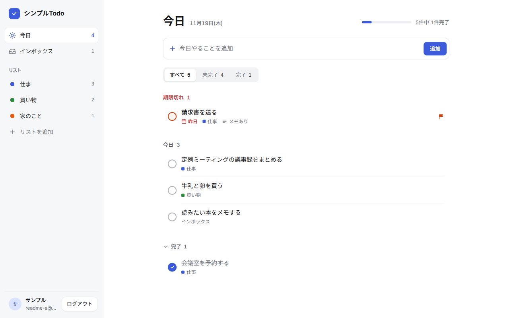
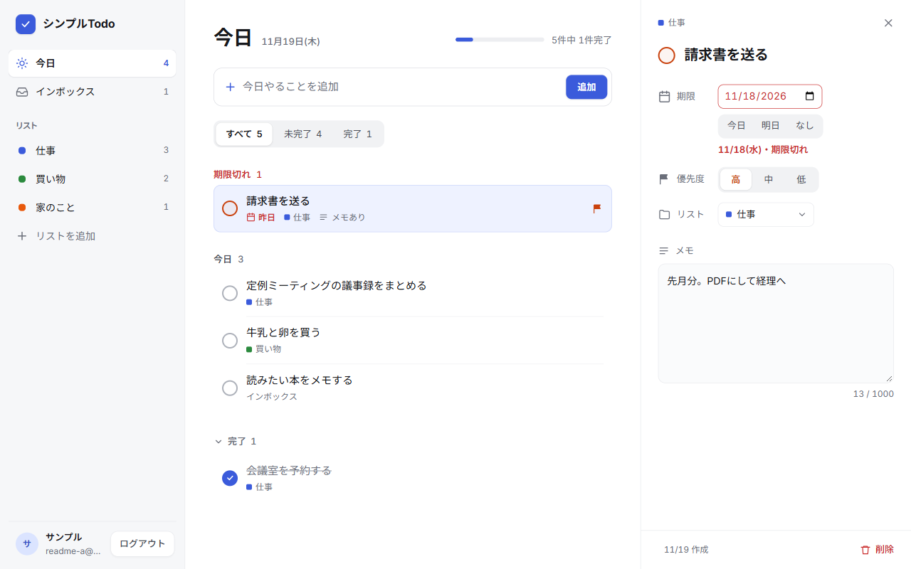
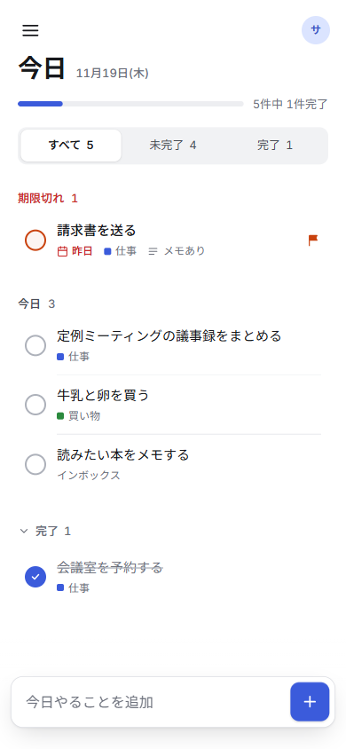
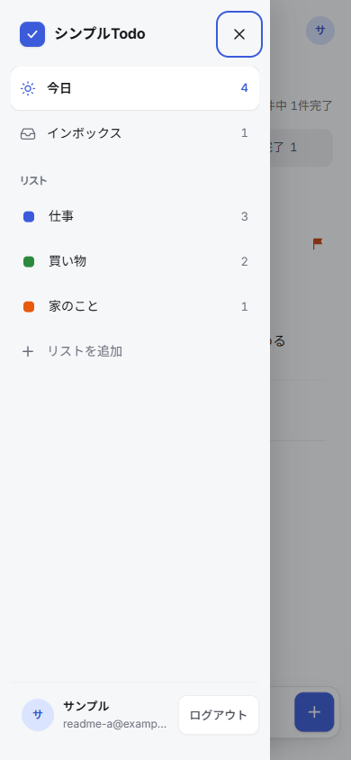
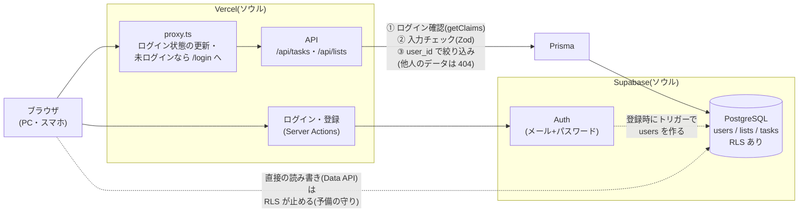

# シンプルTodo

やることを1か所にまとめ、期限と優先度で「次にやること」を迷わず選べる、1人用の Web Todo アプリです。PC とスマホのブラウザで使えます。

**本番:** https://todo-app-rho-steel-65.vercel.app

試す場合は、架空のメールアドレス(例: test@example.com)で登録できます。確認メールは届きません。データは予告なく消すことがあります。

> **English summary**
> A personal to-do web app (Next.js 16, Supabase, Prisma 7), deployed on Vercel.
> I acted as PM / BA: I wrote the spec, split the work into 7 steps, directed Claude Code (an AI coding agent) with written step instructions, and reviewed and accepted each step before moving on.
> All 12 "Must" features are live in production, with per-user data isolation, a "Today" view and mobile support.
> The spec was updated at the end to match what was actually built.

## 画面

| 今日ビュー(PC) | 詳細パネル(PC) |
| --- | --- |
|  |  |

| スマホの一覧 | スマホのメニュー | スマホの詳細 |
| --- | --- | --- |
|  |  |  |

## できること

仕様書の Must 機能 F-01〜F-12 は、すべて本番で動いています。

| ID | 機能 | ひとこと |
| --- | --- | --- |
| F-01 | 新規登録 | メールとパスワードで登録し、そのままログイン |
| F-02 | ログイン / ログアウト | ログイン中だけ、自分のデータが見える |
| F-03 | タスク追加 | 入力して Enter。開いているリストに入る(「今日」なら期限が今日に) |
| F-04 | 一覧表示 | 未完了が上 → 期限が近い順 → 優先度が高い順 |
| F-05 | 完了 / 未完了 | チェックを押すだけ |
| F-06 | 編集 | タイトル・メモ・期限・優先度・リスト。欄から離れると自動保存 |
| F-07 | 削除 | 確認ダイアログのあとで削除 |
| F-08 | 期限 | 期限切れは赤字 |
| F-09 | 優先度 | 高・中・低。「高」には旗 |
| F-10 | リスト | 作成・名前変更・色・削除。消しても中のタスクはインボックスに残る |
| F-11 | 絞り込み | すべて / 未完了 / 完了 |
| F-12 | 「今日」ビュー | 期限が今日以前の未完了タスクを、全リストまとめて表示 |

## 作り方の流れ

私の役割は PM / BA(要件定義・仕様・判断・受け入れ確認)です。コードは AI(Claude Code)が書き、私は「何を作るか」「どこまでで良しとするか」を決めました。

### 1. 仕様書を先に作った
機能一覧、画面、ERD(テーブルの設計図)、API、業務ルール、入力チェックを [docs/spec.md](docs/spec.md) にまとめました。
迷う点は「小さく作って、後で広げやすい」を基準に決めました。たとえば、タグではなくリスト(1タスクに1つ)にする、状態は「未完了 / 完了」の2つだけにする、などです。

### 2. 動くプロトタイプで流れを確かめた
作り始める前に、claude.ai で1ファイルの HTML のプロトタイプを作りました([references/todo-prototype.html](references/todo-prototype.html))。データはブラウザの中だけに保存する作りで、画面の流れと使い心地を確かめました。
(GitHub 上ではコードとして表示されます。ファイルをダウンロードしてブラウザで開くと、そのまま動きます。)

### 3. デザインを作り、磨き、テーマを試した
6画面のデザインのお手本(HTML)を作りました([references/design/html/](references/design/html/))。デザイン用のスキル(AI への指示のまとまり)で見た目を磨き、色・フォント・角丸・影などをすべて「トークン」(名前の付いた値)にしました。そのうえで、ブルー・ピクセル・ピクセル貴族の3つのテーマを切り替えて試し、本番は標準のブルーにしました([テーマの比較スクショ](references/screenshots/theme/))。

### 4. 7つのステップに分け、手順書で AI に指示した
環境づくり → DB → 認証 → タスクの基本と公開 → 編集と削除 → リストと「今日」ビュー → 仕上げ、の7つに分けました。
- 各ステップの指示は手順書([prompts/](prompts/))に書き、守るルールは [CLAUDE.md](CLAUDE.md) に書きました。
- AI には、ステップの終わりに必ず止まって報告させました。報告の内容は、作ったもの、私が確かめる手順、仕様書と違う所や判断した所です。
- 私が画面を触って確かめ、判断が必要な所を決めてから、次のステップに進めました。
- 仕様書にない機能は勝手に足さず、提案して私の確認をとるルールにしました。
- 動作確認は、PC とスマホの両方の幅で AI に試させ、スクショを残させました([screenshots/](screenshots/))。

### 5. 公開と運用まで行い、最後に仕様書を更新した
ステップ4で Vercel に公開し、スマホで実際に使って確かめました。ステップ7で、空の表示・エラー表示・画面幅・キーボード操作などを点検し、受入テストを行いました。最後に、作る途中で決めたこと(URL の形、足した文言、画面幅ごとの表示など)を仕様書に反映しました。今は仕様書を正として、ここから機能を足していく形にしています。

## 私が判断したこと・こだわったこと

- **確認メールなしで、登録後すぐにログイン**: 仕様の「登録したら自動ログイン」と使いやすさを優先しました。
- **リストを消しても、中のタスクは残す**: 消したタスクはインボックスに移します。「リストを消したらタスクも消えた」という事故を防ぐためです。
- **「今日」は端末の日付で判定する**: サーバーの時計(UTC)で判定すると、時差のある地域で日付がずれるためです。
- **テストでは本物のデータに触らせない**: テスト用ユーザーは決まった形のメールアドレスだけで作り、後片付けでもその形だけを消すルールにしました。本番と手元の開発が同じ DB を使っているためです。
- **登録が途中で失敗しない作り**: ユーザー情報は DB の仕組み(トリガー)で自動で作ります。名前などが欠けていても、登録自体は失敗させないようにしました。
- **仕様書の言葉にそろえる**: DB の列名も、仕様書の言葉(メモ = description)に合わせました。
- **文言は自分で決める**: 0件のときの表示(「タスクはありません。入力欄から追加しましょう」「完了したタスクはまだありません」)などは、私が決めました。
- **リストの色**: 色は自動で付けます。あとから「…」メニューで変えられるようにしました。
- **DB を変える手順を残す**: 一度うまくいった手順を CLAUDE.md に書かせ、次からも同じ手順で行えるようにしました。

## つまずいたことと学んだこと

- **Prisma は管理者として DB につなぐので、RLS が効かない**
  RLS(行ごとの読み書き制限)を設定しても、Prisma を通る読み書きには効きません。そこで、API で必ず「ログイン中のユーザーの user_id」で絞り込み、他人のデータには 404 を返すことを本当の守りにしました。RLS は、ほかの道から DB を読まれたときの予備の守りとして残しています。
- **Supabase の直通の接続は IPv6 だけ**
  手元の PC からも Vercel からもつながりませんでした。IPv4 で使える共有の接続口(Shared Pooler)に切り替えました。
- **Vercel は、GitHub につないだ後の push でないとデプロイが始まらない**
  つないだだけでは何も起きませんでした。新しいコミットを push して、デプロイを始めました。
- **DB の変更の試し方**
  Prisma のふつうのやり方(一時的な DB で試す)は、Supabase のログイン用の仕組みが無いため失敗しました。前の設計図と今の設計図を比べて変更点を作る手順に変え、CLAUDE.md に残しました。

## 技術構成

| 分類 | 使ったもの |
| --- | --- |
| 画面・サーバー | Next.js 16(App Router)、React 19、TypeScript |
| DB への接続 | Prisma 7(`@prisma/adapter-pg`) |
| ログイン・DB | Supabase(Auth と PostgreSQL) |
| 入力チェック | Zod 4(画面と API で同じルールを使う) |
| 公開 | Vercel。サーバーの処理も DB もソウル |



## ドキュメント

| ファイル | 中身 |
| --- | --- |
| [docs/spec.md](docs/spec.md) | 仕様書。機能・画面・ERD・API・業務ルールの正解。実装に合わせて更新済み |
| [CLAUDE.md](CLAUDE.md) | AI(Claude Code)に守らせるルールと、DB の変更手順・運用のメモ |
| [prompts/](prompts/) | 各ステップで AI に渡した手順書(step1〜7 と、この README の依頼) |
| [references/](references/) | デザインのお手本と、テーマの比較 |
| [screenshots/](screenshots/) | 各ステップの動作確認のスクショ |

## 手元で動かす方法

**必要なもの**: Node.js 20.9 以上、Supabase のプロジェクト(無料プランで可)。

1. 取ってきて、ライブラリを入れる
   ```
   git clone https://github.com/Erika-san/todo-app.git
   cd todo-app
   npm install
   ```
2. 環境変数のファイルを作る
   `.env.example` をコピーして `.env.local` を作り、4つの値を入れます。どこから値をとるかは、`.env.example` の中に書いてあります。`.env.local` は Git に入りません。
3. Supabase の設定
   Authentication の「Confirm email」をオフにします(登録後すぐにログインするため)。
4. DB にテーブルを作る
   ```
   npx prisma migrate deploy
   ```
   テーブル・RLS・トリガーがまとめて作られます。DB を変えるときの手順は [CLAUDE.md](CLAUDE.md) を見てください。
5. 起動する
   ```
   npm run dev
   ```
   http://localhost:3000 を開きます。
