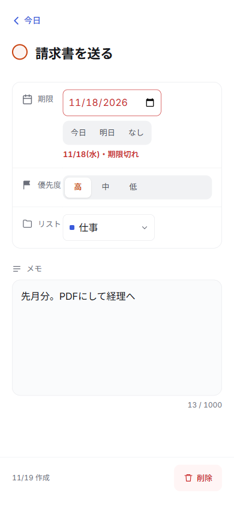
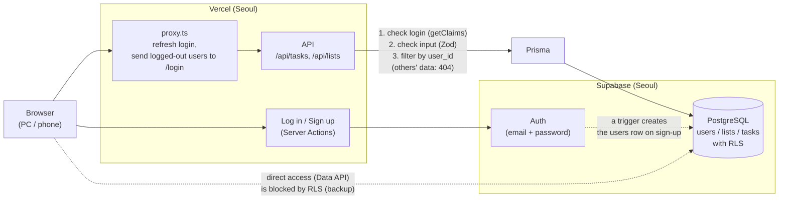

# Simple Todo (シンプルTodo)

A simple to-do web app for one person. It works in PC and phone browsers.
You can sort tasks into lists, set due dates and priorities, and see what to do today.

## Demo

**https://todo-app-rho-steel-65.vercel.app**

To try it:

- You can sign up with a made-up email address (for example, `test@example.com`).
- No confirmation email is sent. You are logged in right after sign-up.
- Data may be deleted without notice.

## Screenshots

The screens are in Japanese.

| Today view (PC) | Task details (PC) |
| --- | --- |
|  |  |

| Task list (phone) | Menu (phone) | Task details (phone) |
| --- | --- | --- |
|  |  |  |

## Features

| ID | Feature | What it does |
| --- | --- | --- |
| F-01 | Sign up | Create an account with email and password. |
| F-02 | Log in / Log out | You can see only your own data. |
| F-03 | Add a task | Type a title and press Enter. The task goes into the open list. In the Today view, the due date is set to today. |
| F-04 | Task list | Open tasks come first, then the nearest due date, then the highest priority. |
| F-05 | Done / Not done | Click the check circle to switch. |
| F-06 | Edit a task | Change the title, memo, due date, priority, and list. Changes save automatically. |
| F-07 | Delete a task | A confirm dialog appears before deleting. |
| F-08 | Due date | Overdue dates are shown in red. |
| F-09 | Priority | High, medium, or low. High tasks show a flag. |
| F-10 | Lists | Create, rename, recolor, and delete lists. When you delete a list, its tasks move to the Inbox. |
| F-11 | Filter | Show all, open, or done tasks. |
| F-12 | Today view | Shows open tasks that are due today or earlier, from all lists. |

The "Inbox" holds tasks that are not in any list.
"Today" uses the date on your device, not the server date.

## Tech stack

| Area | What is used |
| --- | --- |
| Web app | Next.js 16 (App Router), React 19, TypeScript |
| Database access | Prisma 7 (with `@prisma/adapter-pg`) |
| Login and database | Supabase (Auth and PostgreSQL) |
| Input checks | Zod 4 (the same rules on the screen and in the API) |
| Hosting | Vercel. The server and the database are both in Seoul. |

### How data flows

The browser talks to the API. The API checks the user and reads or writes the database through Prisma.

There are three layers of protection:

1. **Login check.** The server checks the login token with `getClaims()`.
2. **Filter by user.** Every API query uses the logged-in user's `user_id`. Other users' data returns 404 (not found).
3. **RLS (Row Level Security).** A database rule that lets each user read and write only their own rows. Prisma connects as an admin, so RLS does not apply to it. RLS is a backup for direct access to the database.



## Getting started

### What you need

- Node.js 20.9 or later
- A Supabase project (the free plan is fine)

### Steps

1. Get the code and install packages.
   ```
   git clone https://github.com/Erika-san/todo-app.git
   cd todo-app
   npm install
   ```
2. Copy `.env.example` to `.env.local`. Fill in the four values.
   `.env.example` explains where to find each value in Supabase. `.env.local` is not committed to Git.
3. In Supabase, go to Authentication and turn off "Confirm email". Users then log in right after sign-up.
4. Create the tables.
   ```
   npx prisma migrate deploy
   ```
   This creates the tables, the RLS rules, and the sign-up trigger.
   To change the database later, follow the steps in [CLAUDE.md](CLAUDE.md) (section 「DB の変更(マイグレーション)の手順」).
5. Start the app.
   ```
   npm run dev
   ```
   Open http://localhost:3000.

## Project structure

| Path | What it holds |
| --- | --- |
| `src/app/(auth)/` | Login and sign-up screens, and their server actions |
| `src/app/tasks/` | The main screen: sidebar, task list, and task details panel |
| `src/app/api/` | The API: `tasks` and `lists` |
| `src/lib/` | Database access, input rules (Zod), login helpers, date helpers |
| `src/proxy.ts` | Runs before each page. Refreshes login and redirects. |
| `src/styles/tokens.css` | Design values (colors, fonts, corner sizes) as CSS variables |
| `prisma/` | Database schema and migrations (including RLS and the trigger) |
| `docs/` | The spec and README images |
| `prompts/` | Step-by-step instructions used to build the app |
| `references/` | Design samples and a first prototype |
| `screenshots/` | Screenshots from the checks at each step |

## Documents

These documents are in Japanese.

| File | What it is |
| --- | --- |
| [docs/spec.md](docs/spec.md) | The spec: features, screens, database, API, and rules |
| [CLAUDE.md](CLAUDE.md) | Rules for the AI coding agent (Claude Code), database change steps, and notes on running the app |
| [prompts/](prompts/) | The instructions given for each build step |
| [references/](references/) | Design samples (HTML), theme screenshots, and a one-file HTML prototype |

## Author

[Erika-san](https://github.com/Erika-san)

## 日本語の要約

1人用の Web Todo アプリです。PC とスマホのブラウザで使えます。
リスト分け、期限・優先度、「今日」ビュー、絞り込みができます。
Next.js 16・Supabase・Prisma 7 で作り、Vercel で公開しています。
架空のメールアドレスで登録して試せます(データは予告なく消すことがあります)。
仕様書などのドキュメントは日本語です。
